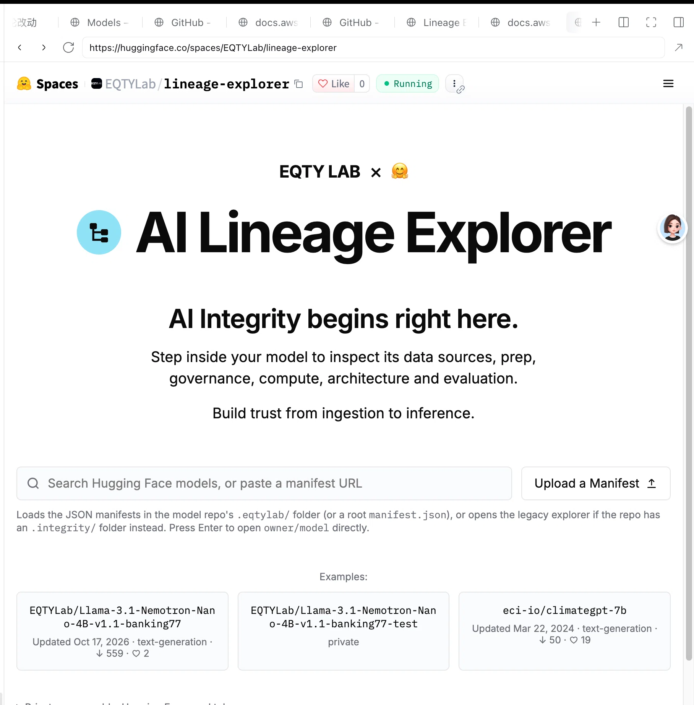
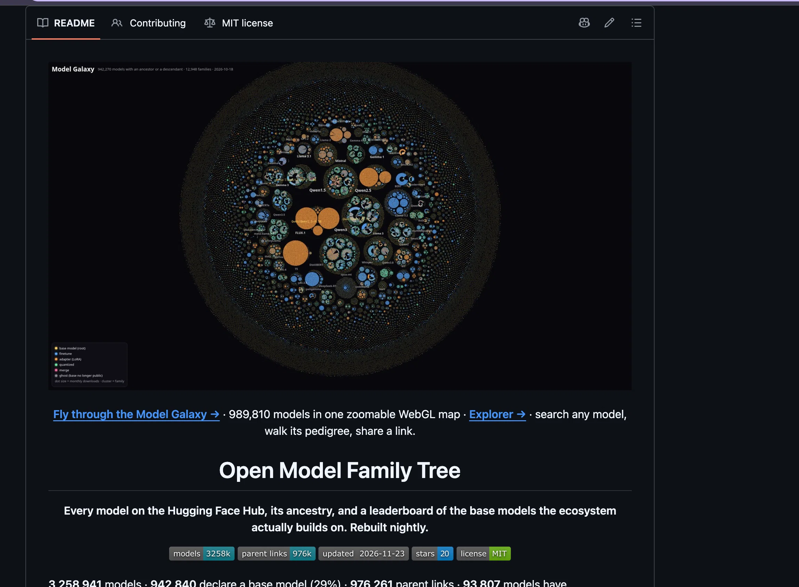
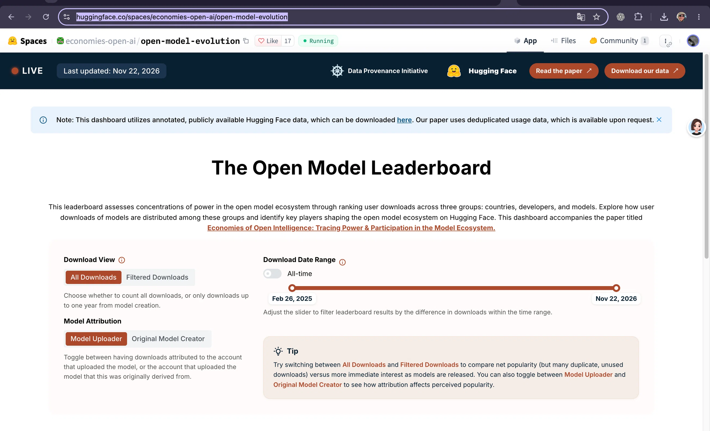

# AI 模型供应链平台：四人分工（v2）

> 2026-11-23 · 取代 v1（v1 按模块切、含"证据核验"、图拆前后端，依赖链太长）
>
> 本版原则：**一人一块领地，代码零跨人 import，只共享冻结契约。**

## 0. 这一版改了什么

| v1 | v2 | 原因 |
|---|---|---|
| 模块三 证据核验 | **删除** | 没有成熟参考，且平台不写"新关系"，只呈现声明关系 |
| 供应链图拆成后端 + 前端两人 | 拆成**大图**和**小图**，各归一人 | 后端/前端拆开会让两人互相等待；大图小图是两个独立产品形态 |
| 目录、图、分析三个模块 | **目录 + 小图一人，大图一人，分析一人，数据与框架一人** | 四个人都有完整领地，可以独立提交 |

## 1. 四个工作包

| 编号 | 工作包 | 负责目录 | 复用来源 | 工时 | 独立验收 |
|---|---|---|---|---|---|
| **A** | 数据与框架 | `backend/shared/`、`backend/modules/data/`、`frontend/src/app/`、`frontend/src/shared/`、`compose.yaml`、`README.md` | hub-stats dump + model-family-tree 字段口径 | ~30h | 新机器按 README 一条命令起服务；`/api/imports` 重复导入不产生重复记录 |
| **B** | 目录搜索 + 小图 | `backend/modules/catalog/`、`backend/modules/lineage/`、`frontend/src/modules/catalog/`、`frontend/src/modules/lineage/` | lineage-explorer（界面） | ~32h | 搜模型 → 看详情与数据集 → 展开局部上下游 → 点边看来源 |
| **C** | 大图（Model Galaxy） | `backend/modules/galaxy/`、`frontend/src/modules/galaxy/` | model-family-tree 的 galaxy（MIT，可改） | ~30h | 全量点云可缩放；按家族/关系类型着色；点点能跳到小图 |
| **D** | 生态分析 | `backend/modules/analysis/`、`frontend/src/modules/analysis/` | open-model-evolution（只参考版式） | ~28h | 指标可手算核对；三张榜可切换；可跳转到模型 |

## 2. 每人的交付清单

### A · 数据与框架（李默涵）

**范围**

- 数据导入：`fixtures`（样例）、`hubstats`（仓库根 `models.parquet`）、`modeltree`（`model-family-tree-main/dist`）三个源；
- 快照管理：来源、哈希、规则版本、范围说明；
- 模型—数据集关联表；
- 框架：`app.py` 只注册路由、`shared/` 全部文件、`.gitignore`、`compose.yaml`、README、四人 onboarding 说明；
- 集成与交付：第 7 天串流程、换机验证、固定演示数据。

**接口（自己实现，别人只读契约）**

```
POST /api/imports        导入
GET  /api/snapshots      数据版本
GET  /api/health         就绪检查
GET  /api/meta           上限常量与关系类型
```

**不做**：任何页面的业务逻辑（只做一个数据管理页）。

**验收**

```bash
cd backend && python -m scripts.seed --source hubstats --limit 20000
pytest tests/data -q
```

---

### B · 目录搜索 + 小图

**范围**

- 目录：搜索框（防抖 + 分页 + 空结果提示）、详情面板（属性、家族、下载量、许可证、关联数据集）、"在图里打开"跳转；
- 小图：Cytoscape 局部图，上/下游/双向切换、深度 1–2、关系类型筛选、节点点击展开、边点击看来源、截断提示、ghost 节点虚线。

**接口**

```
GET /api/models?q=&family=&page=&page_size=
GET /api/model?model_id=
GET /api/graph?model_id=&direction=&depth=&relation_type=&limit=
```

**复用 lineage-explorer 的方式**



- 借：左右分栏（图 + 侧栏）、点节点上的"+"只展开一层、边详情面板的信息组织、"当前只显示局部"的明示。
- **不借**：它的数据来源。lineage-explorer 读模型仓库里的 `.eqtylab/` manifest，全 HF 只有极少数模型有；我们的数据来自 `base_model` 标签，必须自己查库。
- 代码是 Apache-2.0，若改它的 `explorer/explorer.js` 必须保留版权声明并写进 `THIRD_PARTY_NOTICES.md`。**建议重写，只借交互。**

**验收**：搜索 2s 内返回；样例图上环不死循环、截断有提示、ghost 标注"属性未收录"。

---

### C · 大图（Model Galaxy）

**范围**

- 全局点云：94 万个有血缘的模型按布局聚成星系，家族着色，缩放平移；
- 顶部指标条：模型总数 / 声明 base model 的比例 / 父链接数 / 家族数；
- 筛选：按关系类型（finetune / adapter / quantized / merge）高亮；
- 交互：点一个点 → 卡片（模型 ID、家族、下游数）→ "在小图中打开"（带 `model_id` 跳 B 的页面）。

**接口**

```
GET /api/galaxy?family=&relation_type=&limit=
GET /api/galaxy/point?model_id=
```

返回预计算坐标数组，**不要在前端算布局**。

**复用 model-family-tree 的方式**



- 它 MIT，`site/galaxy.js` + `modeltree/galaxy.py` 可以直接改：布局、点大小（下载量）、家族配色、LOD 分级；
- `dist/galaxy/` 产物是布局结果，可直接当基线数据；
- 必须保留 `LICENSE` 与版权声明（Copyright (c) 2026 Hesham Haroon）。

**性能约束**：首屏 ≤ 5MB 传输，≤ 3s 可交互；超过 20 万点降采样。

---

### D · 生态分析

**范围**

- 指标卡：模型数、唯一上下游对、类型分布、有下游的模型数、家族数、环上节点数；
- 三张榜：上游 Top 10（直接下游 / 可达后代两种口径）、家族 Top 10、作者 Top 10；
- 榜单可切换、可搜索、点击跳模型；
- 案例区：2–3 个真实案例（Qwen / Llama / FLUX 系）。

**接口**

```
GET /api/analysis?snapshot_id=
GET /api/analysis/ranking?by=upstream|family|author&metric=direct|total
```

**复用 open-model-evolution 的方式**



- 它用 Dash + Plotly，**README 未声明许可证** → 不复制代码，只借版式：左侧筛选 + 右侧榜单 + 顶部口径切换 + 每张榜下面的口径解释。
- 论文 arXiv:2512.03073 可以引用，说明"下载量集中度"这类指标的定义。

**验收**：固定样例上手算一遍写进测试；榜单排序稳定；口径差异写在页面上（直接下游 ≠ 可达后代）。

---

## 3. 目录结构

```text
backend/
  app.py                      # A：只注册路由
  shared/                     # A：冻结契约，其他人只读
    contracts.py  db.py  errors.py  config.py
    migrations/002_xxx.sql    # 每人一个号段
  modules/
    data/                     # A
    catalog/  lineage/        # B
    galaxy/                   # C
    analysis/                 # D
  scripts/seed.py             # A
frontend/src/
  app/                        # A：导航、路由（每人加一行）
  shared/                     # A：api.ts types.ts 样式
  modules/
    catalog/  lineage/        # B
    galaxy/                   # C
    analysis/                 # D
fixtures/                     # A 冻结，B/C/D 只读
tests/
  data/ catalog/ galaxy/ analysis/
  integration/                # 第 7 天一起写
docs/
  CONTRACTS.md  THIRD_PARTY_NOTICES.md  DEPLOY.md
```

## 4. 三条边界

1. **只 import `shared/`**。跨人调用 = 改契约，不许 `from modules.graph import ...`。
2. **契约第 1 天冻结**。`contracts.py`、`types.ts`、`fixtures/` 定完后，改动要四人同意并在群里说一声。
3. **数据库只加不改**。每人只写自己编号的迁移文件，不动别人的表。

## 5. 复用与许可（写进报告）

| 项目 | 许可 | 我们怎么用 | 义务 |
|---|---|---|---|
| [model-family-tree](https://github.com/h9-tec/model-family-tree) | **MIT** | C 直接改 galaxy 代码；A 借字段口径 | 保留版权声明与 LICENSE，写 `THIRD_PARTY_NOTICES.md` |
| [lineage-explorer](https://huggingface.co/spaces/EQTYLab/lineage-explorer) | **Apache-2.0**（README 声明） | B 只借交互，重写代码 | 若复制代码需保留 NOTICE 与修改说明 |
| [open-model-evolution](https://huggingface.co/spaces/economies-open-ai/open-model-evolution) | **未声明** | D 只借版式与指标定义 | 不复制代码；引用论文 arXiv:2512.03073 |
| hub-stats dump | Apache-2.0 | A 的原始数据 | 标注来源与快照日期 |

> ⚠️ `open-model-evolution` 没有 LICENSE 文件 = 默认保留所有权利。**不要把它任何一段代码（包括 CSS）贴进我们的仓库**，报告里正好写一节"为什么只参考不复制"。

## 6. 两周节奏

| 时间 | 里程碑 |
|---|---|
| 第 1 天 | A 把骨架、契约、fixtures、README 推上 GitHub；四人 clone 后都能跑 `pytest` 和前端 |
| 第 2 天 | 各自跑通空页面 + 样例接口（B 目录、C 空画布、D 空指标卡） |
| 第 3–5 天 | 各自功能成型，第一次合并；第 5 天检查剩余工时 |
| 第 6–7 天 | 接真实数据，走通"搜索 → 小图 → 大图 → 分析"完整链路 |
| 第 8–10 天 | 补交互细节、性能、异常态；交叉测试 |
| 第 11–12 天 | 固定演示数据与案例；换机验证；写报告 |
| 第 13–14 天 | 修阻塞问题、PPT、录像、彩排 |

## 7. 认领

| A 数据与框架 | B 目录搜索 + 小图 | C 大图 | D 生态分析 |
|---|---|---|---|
| 李默涵 | 待认领 | 待认领 | 待认领 |
